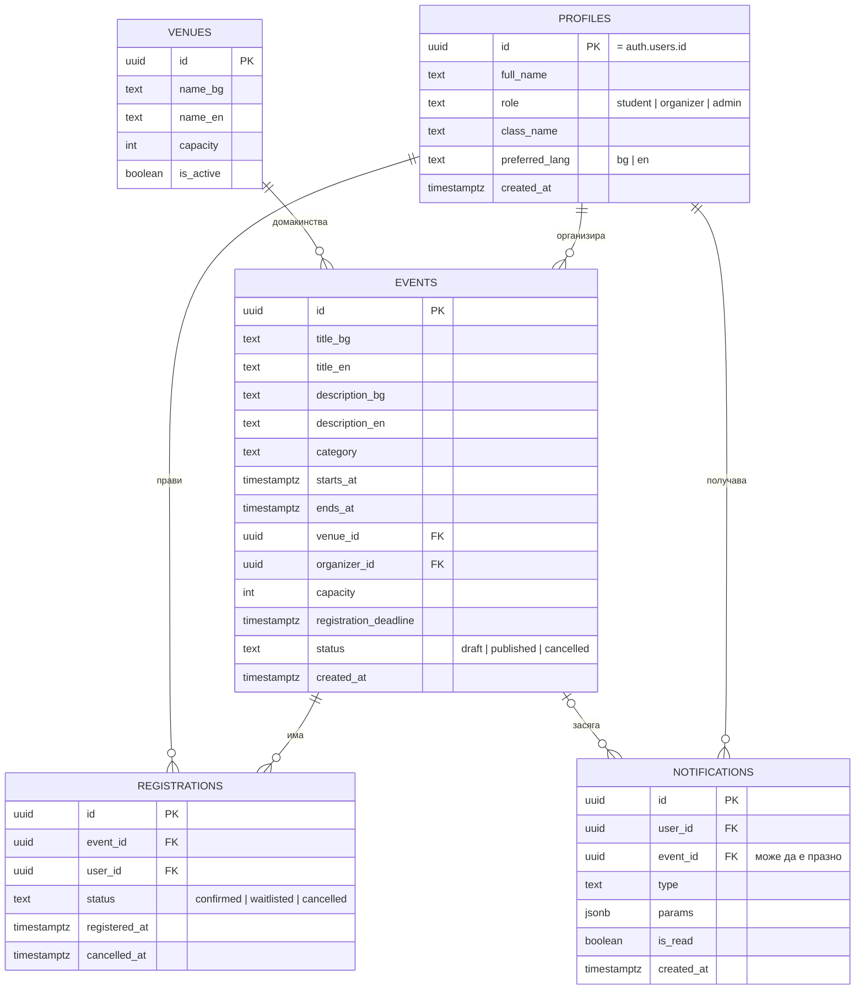

# ER диаграма и модел на данните — EventHub School

> Версия 0.1 · Етап 1. На този етап базата **не е реализирана**; това е планиран модел. `schema.sql` се създава в Етап 2.

Картинка: `docs/design/er-diagram.png` (и `er-diagram.svg`).

## Диаграма (Mermaid — показва се в GitHub)

## Таблици

### profiles

| Поле | Тип | Ограничения |
| --- | --- | --- |
| id | uuid | PK; външен ключ към `auth.users(id)` |
| full_name | text | NOT NULL |
| role | text | NOT NULL, по подразбиране `student`; CHECK (`student`, `organizer`, `admin`) |
| class_name | text | по избор |
| preferred_lang | text | по подразбиране `bg`; CHECK (`bg`, `en`) |
| created_at | timestamptz | по подразбиране `now()` |

### venues

| Поле | Тип | Ограничения |
| --- | --- | --- |
| id | uuid | PK |
| name_bg, name_en | text | NOT NULL (`name_en` може да се копира от `name_bg`) |
| capacity | int | NOT NULL, CHECK > 0 |
| is_active | boolean | по подразбиране `true` |

### events

| Поле | Тип | Ограничения |
| --- | --- | --- |
| id | uuid | PK |
| title_bg, title_en | text | `title_bg` NOT NULL |
| description_bg, description_en | text | по избор |
| category | text | напр. състезание, работилница, клуб, инициатива |
| starts_at, ends_at | timestamptz | NOT NULL; CHECK `ends_at > starts_at` |
| venue_id | uuid | FK → `venues(id)` |
| organizer_id | uuid | FK → `profiles(id)` |
| capacity | int | NOT NULL, CHECK > 0; проверка спрямо капацитета на мястото |
| registration_deadline | timestamptz | CHECK ≤ `starts_at` |
| status | text | CHECK (`draft`, `published`, `cancelled`) |
| created_at | timestamptz | по подразбиране `now()` |

### registrations

| Поле | Тип | Ограничения |
| --- | --- | --- |
| id | uuid | PK |
| event_id | uuid | FK → `events(id)` ON DELETE CASCADE |
| user_id | uuid | FK → `profiles(id)` |
| status | text | CHECK (`confirmed`, `waitlisted`, `cancelled`) |
| registered_at | timestamptz | по подразбиране `now()`; определя реда на чакащите |
| cancelled_at | timestamptz | по избор |
| — | — | **UNIQUE (event_id, user_id)**; индекс по `(event_id, status, registered_at)` |

### notifications

| Поле | Тип | Ограничения |
| --- | --- | --- |
| id | uuid | PK |
| user_id | uuid | FK → `profiles(id)` ON DELETE CASCADE |
| event_id | uuid | FK → `events(id)`, може да е NULL |
| type | text | напр. `registration_confirmed`, `promoted_from_waitlist`, `event_changed`, `event_cancelled` |
| params | jsonb | данни за превод на текста (напр. име на събитие) |
| is_read | boolean | по подразбиране `false` |
| created_at | timestamptz | по подразбиране `now()` |

## Връзки

| От (1) | Към (N) | Смисъл |
| --- | --- | --- |
| profiles | events | организаторът създава много събития |
| venues | events | на едно място се провеждат много събития |
| events | registrations | събитието има много записвания |
| profiles | registrations | потребителят има много записвания |
| profiles | notifications | потребителят получава много известия |
| events | notifications | по избор: известието се отнася за събитие |

## Бележки

- Известията съдържат `type` и `params`, а не готов текст — така се превеждат на BG и EN.
- Записването се променя само през функцията от алгоритъма (виж `PROJECT_PLAN.md`, секция 3).
- Моделът може да се промени в Етап 2 при реализацията в Supabase; промените ще се отразят тук.
