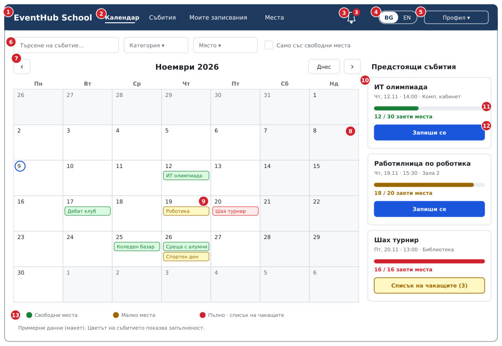
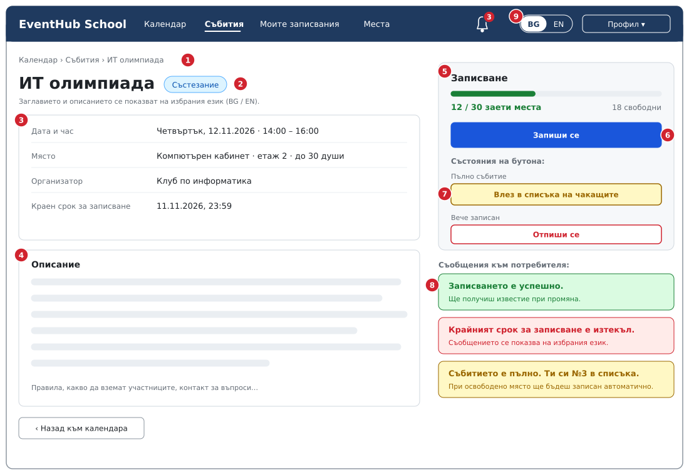
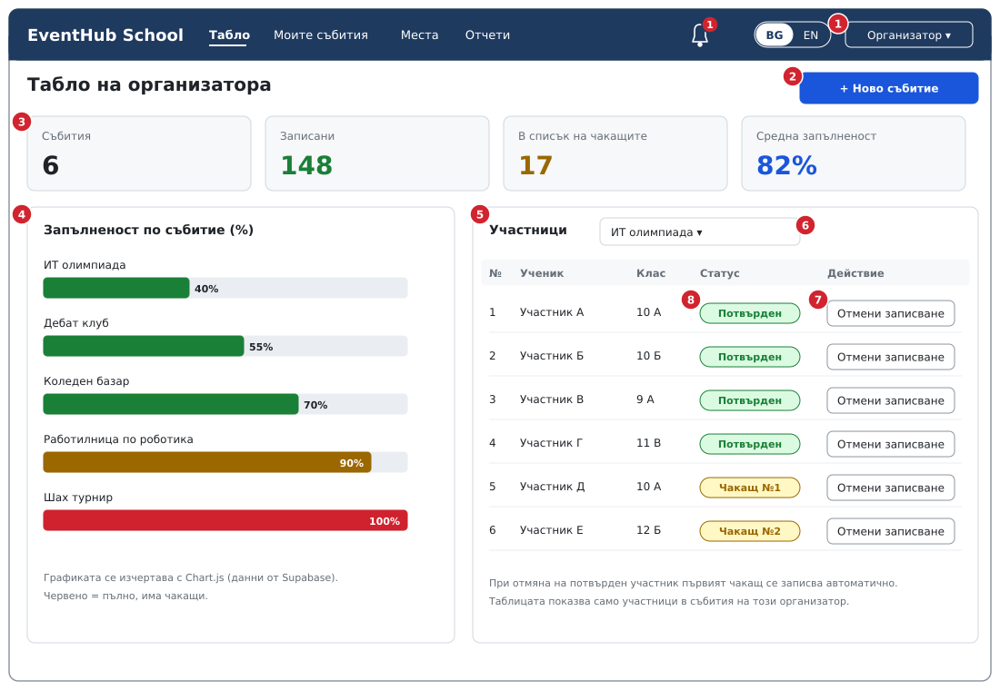
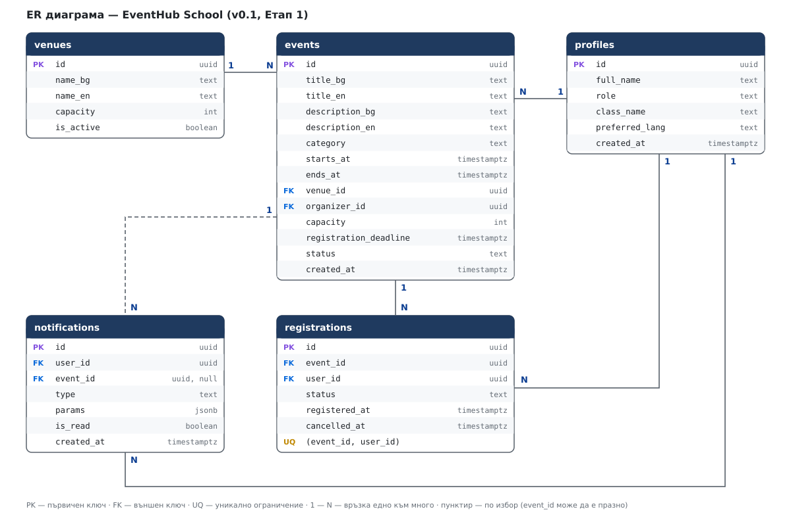

# Скици на екрани — EventHub School

> Макети (wireframes) в SVG и PNG, собствена работа. Данните в тях са примерни. Файлове в `docs/design/`.

Номерата в червено на скиците съответстват на таблиците по-долу.

---

## Екран 1 — Календар

| № | Елемент | Действие на потребителя |
| --- | --- | --- |
| 1 | Лого „EventHub School“ | клик → връща към календара |
| 2 | Навигация: Календар, Събития, Моите записвания, Места | избира раздел |
| 3 | Известия (звънец с брояч) | отваря списъка с известия; непрочетените са отбелязани |
| 4 | Превключвател BG / EN | сменя езика на интерфейса |
| 5 | Профил | вход, изход, настройки |
| 6 | Търсене и филтри (категория, място, „само със свободни места“) | стеснява показаните събития |
| 7 | Бутони за месеца: предишен, днешен, следващ | сменя месеца |
| 8 | Календарна мрежа | клик върху ден показва събитията му |
| 9 | Събитие в деня; цвят според запълненост | клик отваря страницата на събитието |
| 10 | Карта на предстоящо събитие | клик отваря детайли |
| 11 | Индикатор за заети места | показва „N / капацитет“ |
| 12 | Бутон „Запиши се“ или „Списък на чакащите“ | записва потребителя (потвърден или чакащ) |
| 13 | Легенда на цветовете | пояснява зелено, жълто и червено |

---

## Екран 2 — Страница на събитие и записване

| № | Елемент | Действие на потребителя |
| --- | --- | --- |
| 1 | Навигационна пътека | връща към предишен раздел |
| 2 | Заглавие и категория (на избрания език) | — |
| 3 | Дата, място, организатор, краен срок | преглед на информацията |
| 4 | Описание на събитието | четене |
| 5 | Панел „Записване“ с индикатор за места | вижда свободните места |
| 6 | Основно действие „Запиши се“ | записва се за събитието |
| 7 | Други състояния на бутона: „Влез в списъка на чакащите“, „Отпиши се“ | влиза в списъка или се отписва |
| 8 | Съобщения: успех, грешка, позиция в списъка | чете резултата от действието |
| 9 | Превключвател BG / EN | езикът се сменя без загуба на данни |

---

## Екран 3 — Табло на организатора

| № | Елемент | Действие на потребителя |
| --- | --- | --- |
| 1 | Профил с роля „Организатор“ | — |
| 2 | Бутон „+ Ново събитие“ | отваря формуляра за ново събитие |
| 3 | Карти със статистика (събития, записани, чакащи, средна запълненост) | преглед на обобщението |
| 4 | Графика „Запълненост по събитие“ | преглед на запълнеността |
| 5 | Таблица с участниците | преглед на статусите |
| 6 | Избор на събитие | сменя събитието, за което са показани участниците |
| 7 | „Отмени записване“ | отписва участник; първият чакащ се повишава автоматично |
| 8 | Статус: потвърден или чакащ с номер | — |

---

## ER диаграма

Описание на таблиците: [`ER_DIAGRAM.md`](ER_DIAGRAM.md).

## Бележки за реализацията

- Календарът ще се реализира със собствен JavaScript код (без готова календарна библиотека).
- Цветовете са съчетани с текст (напр. „пълно“), не само с цвят.
- Мобилен изглед: календарът преминава в списък по дни; страничната колона се премества под него (в Етап 2).
